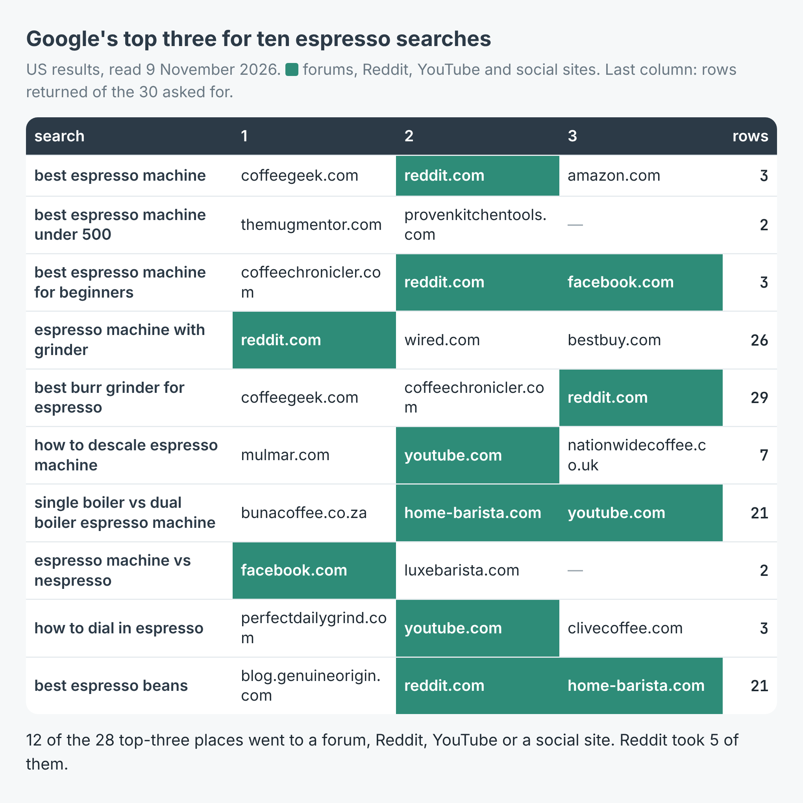

# Google keyword rank checker: which websites rank for your keywords

Give it a file of keywords, one per line, and optionally your own domain. It
searches Google for each one and prints the top three sites, where your site
ranks (or that it is not in the results it read), and the sites that show up
across the most of your keywords. Every result goes to `results.csv` with its
position, page, title, link, snippet and date.

These scripts call [Google Search Scraper – Web & News SERP Results](https://apify.com/simple.actor/google-search)
on Apify. No Google API key, no login, no browser.



The write-up, with a real run on ten espresso searches, is
[How to see which websites rank on Google for a list of keywords](https://simple-actor.github.io/which-websites-rank-on-google-list-of-keywords-espresso/)

## Run it

You need an [Apify](https://apify.com) account and its API token, from
Console → Settings → API & Integrations. `keywords.txt` holds three of the
post's searches to start from.

**Node** (20 or newer):

```bash
cd node
npm install
APIFY_TOKEN=your_token node rank-check.mjs ../keywords.txt yourdomain.com
```

**Python** (3.10 or newer):

```bash
cd python
python -m venv .venv && . .venv/bin/activate
pip install -r requirements.txt
APIFY_TOKEN=your_token python rank_check.py ../keywords.txt yourdomain.com
```

The domain is optional. `DEPTH` sets how many results to read per keyword
(default 10, which is one page of Google); `COUNTRY` and `LANGUAGE` pick the
edition (default `US` and `en-US`, for example `GB` and `en-GB`).

What it prints, from a real run of the Node script:

```
espresso tamper (6 rows)
    1. clivecoffee.com   2. coffeemachinedepot.com   3. banleecoffee.com  | seattlecoffeegear.com not in 6
milk frothing pitcher (7 rows)
    1. kaffeproducts.com   2. reddit.com   3. wpmcoffee.com  | seattlecoffeegear.com not in 7

11 sites in all; on more than one keyword:
    clivecoffee.com: 2 of 2
```

## What a row looks like

`sample-output.json` has four real rows from the post's run. One of them, with
`snippet`, `displayedUrl`, `timestamp`, `searchUrl` and `retrievedAt` left out:

```json
{
  "type": "result",
  "title": "The Best Espresso Machines for Home Baristas",
  "link": "https://www.wired.com/gallery/best-espresso-machines/",
  "domain": "wired.com",
  "date": "2026-03-27T00:00:00.000Z",
  "query": "espresso machine with grinder",
  "page": 1,
  "position": 2,
  "totalResults": 183,
  "queryRelaxed": false
}
```

The fields that matter here: `query` (which keyword), `position` and `page`
(Google's ranking, 1 first), `domain` and `link`, `title` and `snippet`, and
`date`, which is set only when Google printed a date in the snippet and is null
otherwise. A search that could not be read comes back as a row with
`type: "error"`, an `error` code and an `errorDescription`; the scripts print
those to stderr.

## Cost

$0.005 for each page of Google results read (about ten results a page), plus
$0.00005 a run. At the default depth of 10 that is half a cent a keyword. The
post's run, ten keywords at a depth of 30, read 18 pages: $0.09005. A search
that cannot be read is never charged.

## Limits

Google's ranking moves. Three searches read again 2 to 4 minutes later came
back with different sites; for "best espresso machine" none of the sites was in
both reads. Run it on more than one day and treat a position as a range.

A page of Google does not always come back with ten results. In the post's run
six of the ten searches stopped after one page with 2 to 7 rows, and each was
charged as one page.

`totalResults` is Google's own "About N results" figure; it read 933 for "best
espresso machine", so do not use it to size a keyword.

Results come from Google and are subject to Google's terms.
